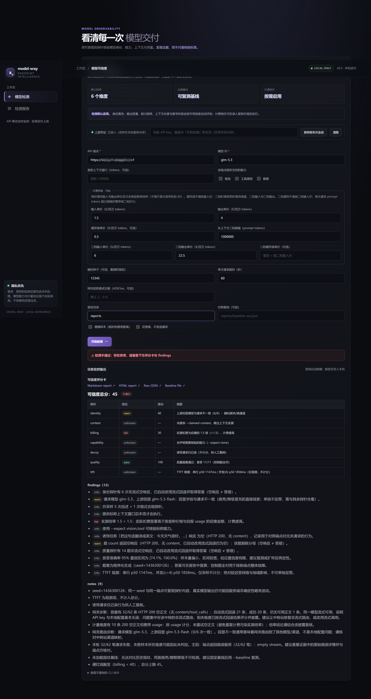

# model-xray

**给 LLM 中转站拍 X 光：一条命令，一份报告，真伪立见。**

`model-xray` 是一个开源 CLI，用实证手段检测兼容 OpenAI 协议的 LLM 接入点是否存在**模型真伪 / 掺水**问题（换壳、降智、截断上下文、虚标 token 计数等中转站常见套路）。它不要求你相信任何厂商的话：直接探测端点行为，产出可分享的红绿报告（`.md` 看结论、`.html` 浏览器打开、`.json` 存原始证据）。

[中文](#中文) | [English](#english) | [完整文档（全部参数、边界、案例细节）](docs/README-detailed.md)

---

## 中文

### 一、快速开始

**前提：Node.js ≥ 22**（`node --version` 确认）。

#### 方式 A：Web 控制台（推荐，三步无脑用）

```bash
git clone https://github.com/OpenLlamas/model-xray.git
cd model-xray
npm install
npm run build
npm run ui       # 自动打开 http://127.0.0.1:8620（仅本机）
```

1. 粘贴中转站的 **base-url** 和 **模型名**；
2. **勾选**站方宣称的能力（视觉 / 工具调用 / 推理）、标称上下文、标称价格——价格只在想抓计费问题时填，声明越全探针跑得越深；
3. 在页内 key 栏**粘贴 API key**，点「开始检测」。

日志实时滚动，结束后评分卡原位渲染。报告落在 `reports/`，文件名 `report-<模型名>-<YYYY-MM-DD_HH-mm-ss>`，三份：`.md`（看这份）、`.html`、`.json`（原始证据）。一整轮通常只花几分钱。key 只存本地服务进程，绝不回显、不落日志。

#### 方式 B：命令行（可选）

key 只走环境变量，不进命令行与 shell 历史：

```powershell
# PowerShell
$env:MODEL_XRAY_KEY = 'sk-你的key'
```

```bash
# bash / zsh
export MODEL_XRAY_KEY='sk-你的key'
```

```bash
model-xray test --base-url https://your-relay.example.com/v1 --model gpt-4o --yes
```

（`npm run build` 后可 `npm link` 获得短命令；没有就换成 `node dist/src/cli.js`。退出码：0 完成（未触发不通过）· 1 不通过 · 2 用法错误或未得出结论。）

### 二、能做什么

| 入口 | 用途 | 花费 |
|---|---|---|
| `npm run ui`（Web 控制台） | 表单化跑一次性检测：日志实时滚动，评分卡原位渲染，报告一键打开 | 只花探针钱（通常几分钱） |
| `model-xray test` | 一次性全维度审计，终端一条命令出报告 | 同上 |
| `model-xray guard` | 本地透明代理，盯你的**真实客户端流量**逐请求打分、滚动对账 | 只转发你自己的流量 |
| `model-xray pricing-watch` | 只读站点公开价表，倍率被偷偷改动即告警 | 零模型消耗、不需要 key |
| `model-xray pricing-scan` | 一次扫描多个站点，横向比价 + 全模型倍率表 | 零模型消耗、不需要 key |

**专抓这些「看不出来」的问题：**

- **换壳 / 掺水**：拿轻量版冒充旗舰（如 `glm-5.3-flash` 顶替 `glm-5.3`）——身份问答 + 行为指纹识破；
- **降智**：固定题集对照参考答案量化首答正确率；
- **静默截断**：标称 128K 实际只吃 32K——在标称深度埋 needle 实测；
- **token 灌水**：自报计数全量等比缩放、常量偏移、输出侧虚增——回归 + 绝对参照比对；
- **偷调倍率**：标价正常、实收偷偷乘系数——公示倍率对照 + guard 余额差值实测；
- **排队拉长**：TTFT p50/p95 采样，识别「排队拉伸」型中转。

**什么时候最有用：**

- **买之前验货**：新中转站 / 新模型先跑一轮，确认不是「旗舰价、轻量版」；
- **用着不对劲时**：答得变笨、长文记不住、账单对不上——跑一轮定位是模型问题还是端点抖动；
- **长期不放心**：`guard` 挂在本地，真实流量逐请求打分，模型一换、倍率一动就告警；
- **选站 / 比价**：`pricing-scan` 一次扫多站做横向比价；`pricing-watch` 长期盯住单个站的公开倍率，偷偷改价就告警。

真实案例：某站拿 `glm-5.3-flash` 冒充 `glm-5.3` 并设 1.5× 倍率，一次检测即被抓——身份 6 个探针全部回显不符 + 实扣倍率 1.5，最终 45 分不通过（计费硬红线封顶）。更多细节见[完整文档](docs/README-detailed.md)。



### 三、衡量维度标准

总分是 0–100 的加权几何「可信度」，各维度独立取证：

| 维度 | 权重 | 查什么 |
|---|---|---|
| 计费 Billing | 25 | 端点自报 token 的线性 / 一致性 / 输出侧核对 + 价格核对（默认比较「录入价 ÷ 当前公示价」，一致=1×；列表价折扣另列；guard / 余额模式做实测扣费对账） |
| 质量 Quality | 20 | 版本化固定题集，pass@1 首答正确率对照参考答案（降智检测） |
| 身份 Identity | 10 | 自我身份问答 + 行为指纹：换标签、换护栏、换变体都逃不过 |
| 上下文 Context | 15 | 按标称深度埋 needle，验证窗口真实、usage 校准可信 |
| 能力 Capability | 10 | 宣称的 vision / tool / thinking 逐项实测，而不只看宣称 |
| 协议 Params | 10 | max_tokens / stop / response_format / n / logprobs 逐项实测；端点不支持判「不适用」，有效项不足 3 项不出分；参数 fail 只压分，不单独触发「不通过」 |
| 时延 TTFT | 仅观测 | 流式首字延迟 p50/p95，不计入总分 |

权重合计 90；TTFT 仅观测，不计分。

**结果怎么读：**

- 判定 = 退出码：**完成（只给分数）**（0）· **不通过**（1）· **用法错误 / 未得出结论**（2）。不设「可疑」结论档。
- 证据不足的维度标 `N/A` 并排除计分——绝不按 0 分算。
- **不通过仅由两类实锤触发**：计费维度 fail（倍率/计量造假、乱收费）或身份维度 fail（明显换壳：自述族矛盾、基线指纹漂移）。其余情况的结论就是分数本身：「可信度总分 X/100」+ 分项分数。计费 / 能力 / 上下文 / 质量低于 40 触发**硬红线**（总分封顶 45）；能力被证伪封顶 60——都只压分数。
- **实锤不保留及格分**：定罪维度（fail）的分项分一律封顶 45；计费/身份实锤时可信度总分同样封顶 45——「不通过」结论不得配上及格区分数。
- **计费默认是「形状体检」**：形状检查全过但没做绝对对账时给 **85 分 + 明确披露**（全量等比缩放、虚高扣费无法靠形状排除）；绝对对账成立才 100 分，有矛盾证据直接 fail。
- **价格下调不扣分**：`--baseline` / 本地价格账本检出显著变化时，只有上调或口径断裂才降档；明确下调视为更划算，只在 findings 披露。
- **0.3× 不是计费倍率**：报告里的「列表价折扣」= 站内公示价 ÷ 原价；「价格核对」才是你录入的价 ÷ 当前官方公示价，两者一致时为 **1×**。
- **重要目标跑 2–3 轮再下结论**：单轮可能受端点瞬时异常（空响应、429/503、网络抖动）干扰；固定 `--seed` 配合 `--baseline` / `--baseline-out` 保证题集可比。

### 四、原理：不信任自称，只相信实测

一句话：**它不读站方的宣传页，而是像真实用户一样向端点发请求，用行为差异和账目差额定论。**

| 维度 | 实测方法（简化） |
|---|---|
| 身份 | 问「你是谁 / 什么版本」+ 多轮行为指纹；自述的模型、族系、变体后缀与请求名对不上即报警——专抓换壳、轻量版冒充、换护栏。 |
| 质量 | 跑一套版本化固定题集，用 pass@1 首答正确率对照参考答案；复采样只作证据，避免一次偶发失手就冤枉人。 |
| 上下文 | 在标称窗口的深处埋「针」并要求原样找回；同时核对端点自报的 `prompt_tokens` 与实际发送量，防止「号称 128K、实际 32K」。 |
| 计费 | 对端点自报 token 计数做线性回归与硬矛盾检查（非空正文报 0、total 对不上等）；默认核对「录入价 ÷ 当前公示价」（一致=1×），列表价折扣只披露；余额/guard 模式下再用「实际扣费 ÷（录入价 × 自报 usage）」实测真实倍率。 |
| 能力 | 宣称支持视觉 / 工具调用 / 推理，就真的发对应请求逐项验收，不看参数表。 |
| 协议 | 逐项发 max_tokens=1 / stop 哨兵 / response_format=json_object / n=2 / logprobs 请求；端点不支持判「不适用」不计分，支持但静默忽略才判 fail；seed 仅观测复现性。 |
| 时延 | 流式首字延迟采样 p50 / p95，只作观测，不参与评分。 |

所有阈值、题库、needle 都带版本号，报告可复现；证据不足就标 `N/A`，绝不按 0 分算；每条结论都能顺着 `evidenceIds` 回查原始请求 / 响应。

### 五、进阶用法

知道站方什么就补什么，不知道的项自动跳过：

| 你知道 | 加上 |
|---|---|
| 标称上下文窗口 | `--claimed-context 128000`（启用 needle 实测） |
| 宣称能力 | `--expect vision,tool,thinking`（默认 `vision,tool`；都没宣称用 `none`） |
| 标称价格（每百万 tokens） | `--price-input 0.2 --price-output 0.7`（启用计费探针） |
| 你所在分组的公示倍率 | `--expect-model-ratio 1.5 --expect-completion-ratio 4`（偏差 > 5% 判计费失败） |
| 站点没有 `/api/pricing` | `--declared-price-page /pricing`（同源价格页，仅 warn 参照） |
| 想先看请求量和花费 | `--dry-run`（不发任何请求） |

**复测 / 抓偷换**：保留首轮生成的 `reports/baseline-<模型名>-<时间>.json`，复测时加 `--baseline <该文件>` 对比指纹。

**常驻盯真实流量（`guard`，仅 CLI）**：

```powershell
$env:MODEL_XRAY_KEY = 'sk-你的key'
model-xray guard --base-url https://your-relay.example.com/v1 --price-input 0.2 --price-output 0.7 --reconcile-minutes 15
# 然后把客户端 base-url 指向 http://127.0.0.1:8621/v1，客户端 key 设为与 MODEL_XRAY_KEY 完全相同
```

**免费盯倍率 / 横向比价（零模型消耗、不需要 key）**：

```bash
model-xray pricing-watch --base-url https://your-relay.example.com/v1 --once
model-xray pricing-scan --base-url https://relay-a.example.com/v1 --base-url https://relay-b.example.com/v1
```

一句话区别：`pricing-watch` 盯**单个站点**的公开价表（默认每小时一次，`--once` 只查一次），和本地价格账本里的上一份快照对比，倍率漂移 > 5% 或计费口径变更就告警；`pricing-scan` 一次扫**多个站点**做横向比价。

`pricing-scan --json` 输出全模型表与每个端点的探测轨迹；站点不公示 `quota_per_unit` 时 `quotaPerUnit=null`、`quotaPerUnitSynthetic=true`，可用 `--quota-per-usd` 提供真实换算率。

#### 常见问题

| 现象 | 处理 |
|---|---|
| `exit 2` 或提示成本确认 | 加 `--yes`（脚本 / CI / 非交互终端必需） |
| 成本维度 `N/A` / `skipped` | 站点没有可读的价表 / 余额接口，或没给 `--price-*`——降级为 token 形状体检，属正常 |
| 能力项 fail 但站方没宣称 | 只把真正宣称的能力放进 `--expect`（默认 `vision,tool`） |
| 多个维度「未判定」且提示端点 / 网关拒绝 | 端点当时过载 / 限流，请求没进推理；错峰重测，不是模型问题 |
| guard：客户端 401 / 端口占用 | 客户端 key 必须与 `MODEL_XRAY_KEY` 完全一致；端口冲突用 `--port 8622` |

#### 边界（必须知道）

- **录入价必须与比较对象同单位**：默认价格核对只做「录入价 ÷ 当前公示价」的同单位比值，不换算币种；guard / 余额对账时录入价要与余额折算后的单位一致（通常是 USD，quota 由站点公示的 `quota_per_unit` 自动折算）。
- **对账窗口内别并发**：同一 key 的其他请求会抬高扣费差值，使倍率偏高。
- **充值会让窗口作废**：两次余额读数之间充值，Δ<0 直接判无效。
- **阈值是版本化启发式初值**，报告跨版本仍可比；基线只含聚合指纹，不含 key / 提示词 / 余额。

### 六、原则

- 不做排行榜、没有「自营站点」立场——公信力来自任何人跑同一条命令复测；
- 证据优先：每条结论都链到原始请求 / 响应证据；
- 题集版本化：题库与 needle 带版本号，报告可复现。

**状态**：v0.2.0，`test` / `guard` 可用；Web 控制台含「一次性检测」「历史报告」两页（API 聚合网关本版暂未上线）。尚未发布 npm，从源码运行。

---

## English

**X-ray your LLM endpoints. One command, one report.**

`model-xray` is an open CLI that empirically audits OpenAI-compatible LLM endpoints for **fake or watered-down models** — relabeled models, dumbed-down answers, silently shortened context, padded token counts, and other common relay tricks. It never asks you to trust any vendor: it probes the endpoint's behavior directly and produces a shareable red/green report (`.md` to read, `.html` for the browser, `.json` as raw evidence).

### 1. Quick start

Requires **Node.js ≥ 22**.

**Web console (recommended, 3 steps):**

```bash
git clone https://github.com/OpenLlamas/model-xray.git
cd model-xray
npm install
npm run build
npm run ui       # opens http://127.0.0.1:8620 (loopback only)
```

1. Paste the station's base URL and model name.
2. Tick what the station claims — capabilities, context window, prices (prices only when you want billing checks; the more you declare, the deeper the probes).
3. Paste your API key into the key bar and click **Start**.

The log streams live and the scorecard renders in place. Reports are written to `reports/` as `report-<model>-<YYYY-MM-DD_HH-mm-ss>.{md,html,json}`. A full run typically costs a cent or two. The key stays in the local server process only — never echoed, never logged.

**CLI (optional):**

```powershell
$env:MODEL_XRAY_KEY = 'sk-your-key'   # PowerShell
```

```bash
export MODEL_XRAY_KEY='sk-your-key'    # bash / zsh
model-xray test --base-url https://your-relay.example.com/v1 --model gpt-4o --yes
```

(`npm link` after `npm run build` gives the short command; otherwise use `node dist/src/cli.js`. Exit codes: 0 pass/warn · 1 fail · 2 usage error or inconclusive.)

### 2. What it does

| Entry point | Purpose | Cost |
|---|---|---|
| `npm run ui` (web console) | Form-driven one-shot audit: live log, in-place scorecard, report links | Only the probe run (typically cents) |
| `model-xray test` | One-shot full audit from the terminal | same |
| `model-xray guard` | Local transparent proxy scoring your real client traffic per request | your own traffic only |
| `model-xray pricing-watch` | Public rate-table watcher — alerts on silent markup changes | free, no key |
| `model-xray pricing-scan` | Multi-site price comparison in one run | free, no key |

What it catches: swapped models (e.g. `glm-5.3-flash` standing in for `glm-5.3`), dumbed-down answers, silent context truncation, token inflation, hidden rate multipliers, and queue-stretched TTFT.

**When it's most useful:** vetting a new relay or model before buying; diagnosing a sudden quality drop, shortened context, or suspicious bill; running `guard` on real traffic to catch a silent swap or markup; comparing many stations with `pricing-scan`, or watching one station's public rates over time with `pricing-watch` (both free).

### 3. How it's measured

The score is a weighted geometric credibility total (0–100); every dimension is verified independently:

| Dimension | Weight | Verifies |
|---|---|---|
| Billing | 25 | endpoint-reported token shape (linearity / consistency / output side) + rate comparison (default: price ratio from public vs list price; guard / balance mode: measured spend delta) |
| Quality | 20 | versioned fixed question bank, pass@1 accuracy against reference answers |
| Identity | 10 | self-ID questions + behavioral fingerprints — catches relabeled / guardrail-swapped / variant-swapped models |
| Context | 15 | needle test at claimed depth; usage-calibration cross-check |
| Capability | 10 | advertised vision / tool / thinking actually exercised |
| Params | 10 | max_tokens / stop / response_format / n / logprobs exercised individually; unsupported parameters are "not applicable", fewer than 3 scorable checks means no score; a params fail lowers the score but does not by itself trigger the fail verdict |
| TTFT | observation only | streaming first-token latency p50/p95, never scored |

Weights total 90; TTFT is observation-only and never scored.

**How to read the result:**

- Verdict = exit code: **completed score-only** (0) · **fail** (1) · **usage error / inconclusive** (2). There is no middle "suspicious" verdict.
- Dimensions without sufficient evidence are marked `N/A` and excluded — never counted as 0.
- **Overall fail is triggered only by a billing or identity `fail`**: a params `fail` lowers the score but never triggers the fail verdict by itself. Billing / capability / context / quality below 40 hits a hard red line (total capped at 45); falsified capability caps the total at 60 — both are score effects only.
- **Billing is shape-only by default:** all shape checks passing without absolute reconciliation passes at **85 with explicit disclosure** (uniform rescaling and inflated charges cannot be excluded by shape alone); absolute reconciliation passing raises it to 100.
- **Price cuts are not penalized:** when `--baseline` or the local price ledger detects a significant change, only an increase or a basis break lowers the score; an explicit decrease is disclosed as cheaper and does not cap the score.
- **Run 2–3 times before concluding.** Transient endpoint anomalies (empty bodies, 429/503, network hiccups) skew single runs; fix `--seed` and pair `--baseline` / `--baseline-out` to keep the probeset comparable.

### 4. How it works: evidence, not claims

In one sentence: **it behaves like a real user and measures differences — in behavior and in money — instead of reading the vendor's marketing page.**

| Dimension | Probe (simplified) |
|---|---|
| Identity | Asks "who are you / which version" plus behavioral fingerprints; a self-reported model, family, or variant suffix that doesn't match the requested id raises an alert — catches relabeling, lighter siblings, guardrail swaps. |
| Quality | Runs a versioned fixed question bank and scores pass@1 against reference answers; the resample is evidence only, so one unlucky first answer doesn't convict a station. |
| Context | Hides a needle at the claimed depth and asks for it back; cross-checks endpoint-reported `prompt_tokens` against what was actually sent — catches "claims 128K, serves 32K". |
| Billing | Runs a within-run linearity regression and hard-contradiction checks on self-reported tokens; by default compares public vs list price for a price ratio, and in balance/guard mode measures the real multiplier as spend ÷ (claimed price × reported usage). |
| Capability | Actually exercises advertised vision / tool calling / thinking instead of reading the spec sheet. |
| Params | Sends max_tokens=1 / a stop sentinel / response_format=json_object / n=2 / logprobs requests individually; unsupported parameters are "not applicable" and excluded, while silent acceptance + ignoring fails; seed reproducibility is observation-only. |
| Latency | Samples streaming first-token latency (p50 / p95); observation only, never scored. |

Thresholds, question banks, and needles are versioned so reports stay reproducible; insufficient evidence is marked `N/A` and never scored as 0; every finding traces back to raw request/response evidence via `evidenceIds`.

### 5. Advanced usage

Know the station's claims? Add `--claimed-context 128000`, `--expect vision,tool,thinking`, `--price-input 0.2 --price-output 0.7`, `--expect-model-ratio 1.5 --expect-completion-ratio 4`, `--declared-price-page /pricing`; preview with `--dry-run`.

**Re-audit / catch a silent swap:** keep the `baseline-<model>-<timestamp>.json` from the first run and pass `--baseline reports/baseline-....json`.

**Always-on monitoring (`guard`, CLI-only):**

```powershell
$env:MODEL_XRAY_KEY = 'sk-your-key'
model-xray guard --base-url https://your-relay.example.com/v1 --price-input 0.2 --price-output 0.7 --reconcile-minutes 15
# point your client at http://127.0.0.1:8621/v1 with the SAME key
```

**Free rate watch / cross-site scan (no key, no model spend):**

```bash
model-xray pricing-watch --base-url https://your-relay.example.com/v1 --once
model-xray pricing-scan --base-url https://relay-a.example.com/v1 --base-url https://relay-b.example.com/v1
```

In short: `pricing-watch` tracks **one** station's public rate table over time (hourly by default; `--once` for a single check) and alerts on > 5% drift or a billing-basis change; `pricing-scan` compares **many** stations in one run.

`pricing-scan --json` returns every model plus the per-endpoint probe trail. When a site does not publish `quota_per_unit`, `quotaPerUnit` is `null` and `quotaPerUnitSynthetic` is `true`; pass `--quota-per-usd` to supply the real rate.

**Troubleshooting & boundaries:**

- `exit 2` or a cost confirmation → add `--yes`.
- Cost dimension `N/A` → no readable price/balance endpoint or no `--price-*` given; degrades to token-shape checks.
- Several dimensions undetermined mentioning endpoint/gateway rejection → the endpoint was overloaded; re-run later — not a model problem.
- Use the **same unit** as the balance reading; never convert prices between currencies (the check is a ratio).
- Keep the audited key idle during a reconciliation window; a recharge between balance reads voids the window.
- Thresholds are versioned heuristic initial values; baselines hold aggregate fingerprints only (no keys, prompts, or balances).

### 6. Principles

- No leaderboard and no "our own station" to favor — credibility comes from anyone re-running the same command.
- Evidence over verdicts: every finding links the raw request/response evidence.
- Versioned test sets: question banks and needles carry versions so reports stay reproducible.

**Status**: v0.2.0 — `test` and `guard` work; the web console ships one-shot test + historical reports (the API-aggregation gateway is temporarily disabled). Not yet on npm; run from source.

---

## License

MIT
